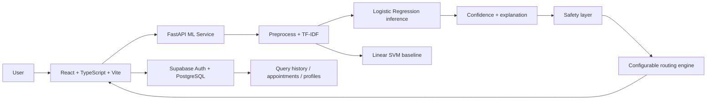

# SehatSetu 2.0 architecture

## Boundaries
- React is responsible for presentation and authenticated client workflows.
- FastAPI owns NLP inference, safety checks and routing decisions.
- Supabase owns identity, persistence and row-level authorization.
- The ML service never claims to diagnose or prescribe.
